# Company Second Brain

**An AI-assisted recruitment platform where language models read the documents and deterministic code makes the decisions.**

[](https://github.com/Amine-Sridi/Company-Second-Brain/actions/workflows/ci.yml)


Upload resumes, paste a job description, and get a ranked, explainable shortlist. Invite the best
match to a voice interview with an AI interviewer, receive a CEFR language assessment, and make the
final decision yourself. Candidate identity lives in one service only, and every score can be
reproduced after the fact.

[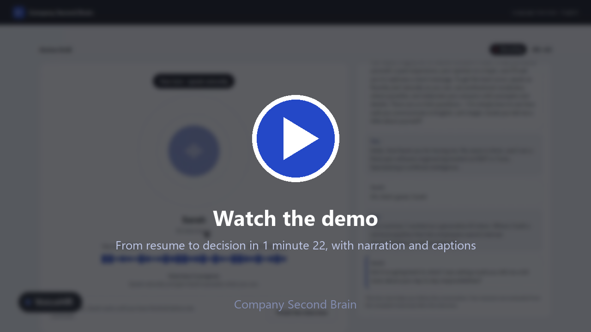](docs/demo/company_second_brain_demo.mp4)

<sub>A 1 minute 22 demo, from resume upload to the recruiter's decision, with narration and
[captions](docs/demo/company_second_brain_demo.srt). The candidate in the interview is a scripted
text-to-speech voice talking to the real interview page and the real Gemini Live session.</sub>

**Contents:** [Why](#why) · [How it works](#how-it-works) · [Architecture](#architecture) ·
[How a match is scored](#how-a-match-is-scored) · [Privacy and security](#privacy-and-security) ·
[The recruiter interface](#the-recruiter-interface) · [Getting started](#getting-started) ·
[Testing](#testing) · [Measured results](#measured-results) · [Limitations](#limitations-and-roadmap) ·
[Repository layout](#repository-layout) · [Documentation](#documentation)

---

## Why

For every open position, recruiters read the same kinds of documents: resumes, a job description,
and a first round of screening answers. Most of that work is repeated. A candidate reviewed for one
position is read again for the next, and what the recruiter learned is lost when the position
closes. Language models can now read this unstructured text, but they bring two risks for a
recruitment tool: a score nobody can explain, and candidate identities sent to systems that do not
need them.

This project answers one question: *how can we use language models to automate the repetitive
stages of recruitment without losing reproducibility, privacy and human control?* It does so with
three rules that shape the whole design:

1. **Models interpret text; code decides.** The LLM never determines a score, a qualification, a
   workflow state or a recruiter decision. It extracts, structures and explains.
2. **Identity lives in one place.** Candidate personal data stays in one service; every other
   service works with an opaque identifier.
3. **Results are immutable and self-explaining.** Each match result keeps what is needed to explain
   and reproduce it, and a later change never rewrites it.

## How it works

1. **Resume ingestion.** A recruiter uploads PDF, DOCX or image resumes. Each file is queued and
   parsed in the background, so the recruiter never waits for the model. The identity stays in Resume
   Intelligence; only an anonymous professional profile moves on, as an embedding in Second Brain.
2. **Job structuring and matching.** The recruiter pastes a job description. Gemini turns it into
   structured criteria, which are validated and, if suspicious, repaired once or flagged. Second
   Brain retrieves the most similar candidates, and deterministic code scores them.
3. **A ranked, explainable shortlist.** Every candidate gets an immutable `MatchResult`: component
   scores, matched and missing skills, and the versions that produced them. A written explanation is
   added afterwards and is advisory only.
4. **Voice interview.** The recruiter selects a qualified candidate and sends an invitation. The
   candidate opens a secure link and talks to Sarah, an AI interviewer, in English or French.
   VoiceHR transcribes the conversation, evaluates it, and sends a signed result back.
5. **Language gate and decision.** A deterministic gate compares the assessed CEFR level with the
   job's requirement and can block an acceptance. Optional human interview rounds add advisory
   input. The recruiter accepts or rejects.
6. **Knowledge graph.** Candidates and jobs are explorable as a focused 2D graph and a 3D landscape.

<p align="center">
  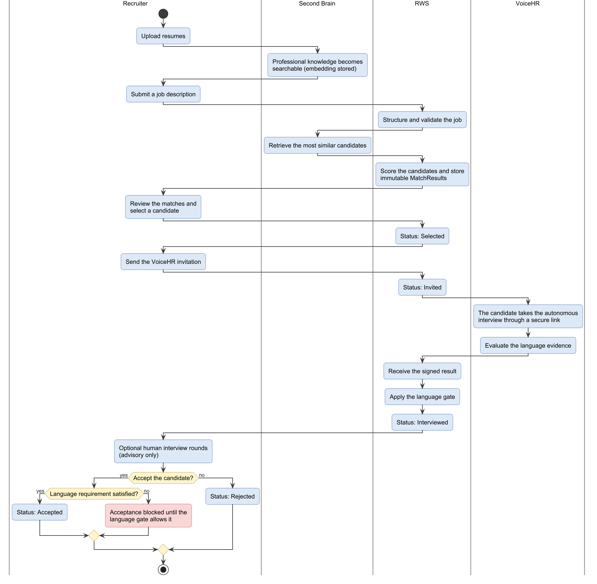
</p>

## Architecture

Four business services, each owning its data, plus a queue, a worker and an optional local model
server. The browser only ever talks to the Recruitment Workflow Service, so service credentials
never reach it.

<p align="center">
  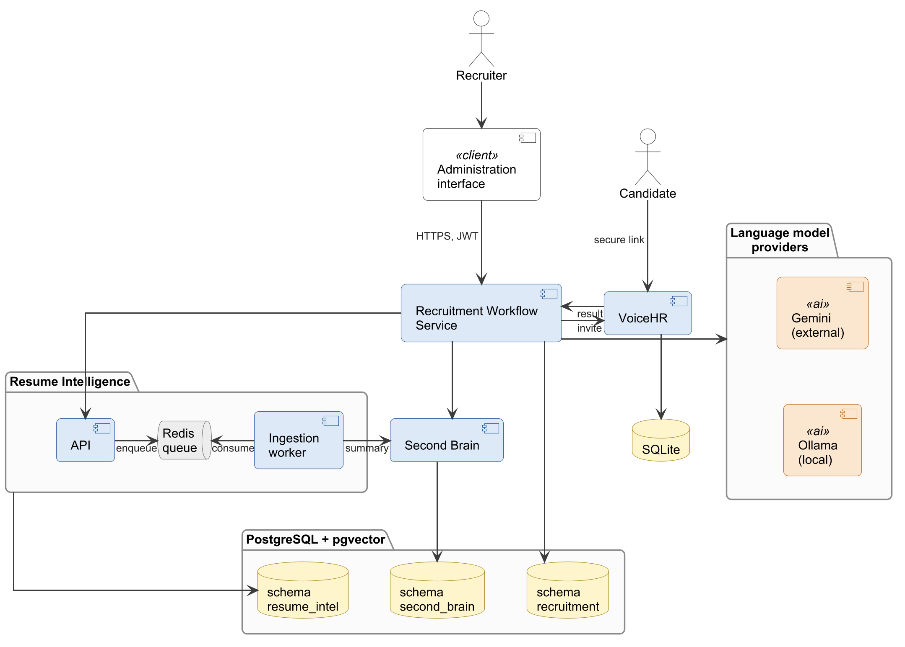
</p>

| Service | Responsibility | Storage |
|---|---|---|
| **Resume Intelligence** | Extracts structure from resumes (text extraction, OCR, Gemini). Owns candidate identity and the ingestion queue state. | `resume_intel` schema, uploads volume |
| **Second Brain** | Stores PII-free candidate knowledge and embeddings. Semantic retrieval with pgvector (768 dimensions, HNSW, cosine). | `second_brain` schema |
| **Recruitment Workflow Service (RWS)** | Job structuring, matching, applications, language gate, recruiter decisions, interview rounds. Serves the recruiter interface. | `recruitment` schema |
| **VoiceHR** | The candidate interview page, the live voice session, transcript, CEFR evaluation, report. | Its own SQLite file |
| Redis + ARQ worker | Moves resume parsing off the request path. Carries opaque job ids only, never personal data. | Transient |
| Ollama (optional) | Local fallback for selected tasks when Gemini is unavailable. | Model files |

**Boundaries that are enforced, not just documented:**

- One PostgreSQL instance, three schemas, three least-privilege roles, **no cross-schema grants**.
  Services reach each other's data only through HTTP APIs.
- Recruiters authenticate with a JWT. Services call each other with `X-Api-Key`. VoiceHR's result
  arrives as an HMAC-SHA256 signed, idempotent webhook.
- Gemini is the primary provider behind a thin `LLMProvider` interface, so changing provider is a
  configuration change. The local fallback is deliberately **not** used for embeddings (a different
  model gives vectors of the same size but a different meaning) or for interview evaluation (no
  local model was reliable enough; see [Measured results](#measured-results)).

The reasons behind each decision are in [docs/ARCHITECTURE_DECISIONS.md](docs/ARCHITECTURE_DECISIONS.md).

## How a match is scored

The scoring is plain Python in [`scoring.py`](services/recruitment-workflow/scoring.py): pure
functions, no database, no HTTP, no LLM.

<p align="center">
  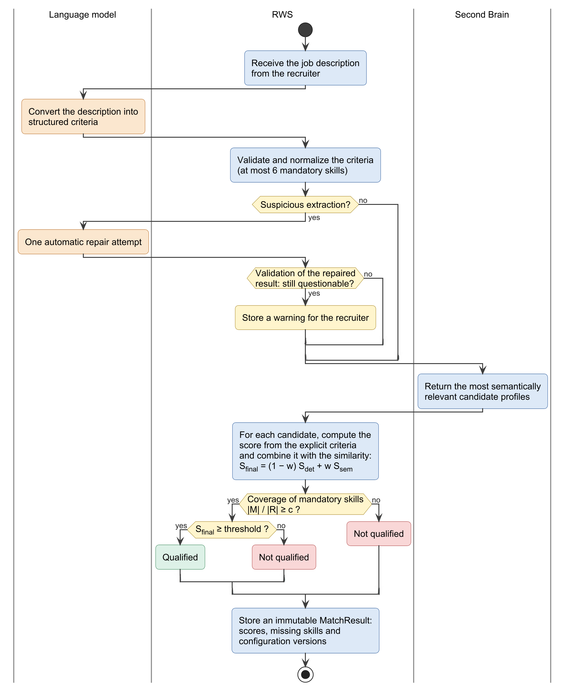
</p>

```text
deterministic = 0.6 × skills + 0.2 × experience + 0.2 × title
final         = 0.5 × semantic + 0.5 × deterministic          (weights from the versioned config)
qualified     = hard gate passed  AND  final ≥ threshold      (threshold defaults to 0.6)
```

| Component | How it is computed |
|---|---|
| **Semantic** | Cosine similarity between the embedding of the whole job description and the candidate's profile, from Second Brain. |
| **Skills** | Matched ÷ (required ∪ preferred) skills, compared case-insensitively as exact strings. |
| **Experience** | 1.0 if the job sets no minimum or it is met, otherwise `years ÷ minimum`. |
| **Title** | All or nothing: 1.0 if any candidate title and any target title contain each other. |
| **Hard gate** | The candidate must hold at least **80%** of the *required* skills. It is independent of the score, so a high semantic score can never make up for missing skills. |

A worked example from a real run: a candidate with all 5 required skills and 3 preferred skills
unmatched has semantic 0.635, skills 5/8 = 0.625, experience 1.0 and title 0. Deterministic is
0.6×0.625 + 0.2×1 + 0.2×0 = 0.575, final is 0.5×0.635 + 0.5×0.575 = **0.605**, which clears the
0.6 threshold: qualified.

Every `MatchResult` is stored with the candidate snapshot, the job-description version, the
scoring-config version, the embedding model version, the threshold, all component scores, and the
matched and missing requirements. A later enrichment of the candidate, or a changed rule, never
rewrites an existing result. The explanation is generated only after the score is persisted.

**What the language model does and does not do**

| The model does | The model never does |
|---|---|
| Extract structure from resumes and job descriptions | Compute `final_score` or `qualified` |
| Embed texts for retrieval | Compare anything with a threshold |
| Write the advisory explanation, after the score exists | Change workflow state or make a recruiter decision |
| Provide evidence for the language assessment | Decide whether a language level is good enough (a deterministic gate does) |

## Privacy and security

<p align="center">
  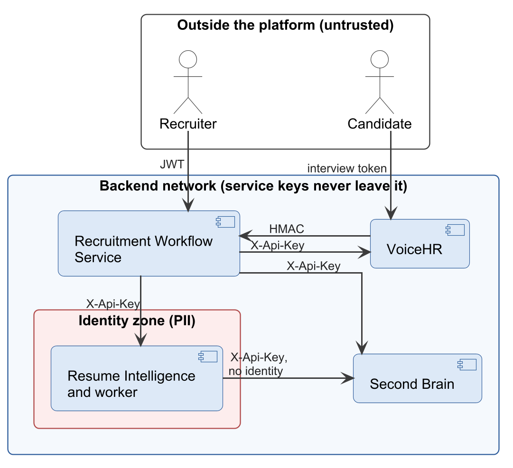
</p>

| Data | Where it lives |
|---|---|
| Name, email, phone, raw resume | **Resume Intelligence only.** Uploaded files sit on a volume mounted only by that service and its worker. |
| Professional knowledge and embeddings | Second Brain, keyed by an opaque `candidate_id`. Its schemas use `extra="forbid"`, so a stray `email` is rejected at the API boundary. |
| Jobs, matches, applications, decisions | The workflow service. It asks Resume Intelligence for contact details only at invitation time and does not store them. |
| Candidate name and email for the interview link | **VoiceHR**, a deliberate and scoped exception: it owns sending the link and greeting the candidate. |

- The resume queue carries only an opaque job id. Redis is never a source of truth; durable job
  state is in Postgres, so a flushed Redis loses throughput, never a candidate.
- Report links expire, rate limits protect login and interview links, and a retention sweep deletes
  recordings, transcripts and contact details by age while protecting active interviews.
- An internal audit found and fixed, among others, a candidate email leaking into a stored error
  message and a webhook whose receipt and state change could be committed separately. See
  [docs/PROJECT_AUDIT_AND_IMPROVEMENT_PROPOSAL.md](docs/PROJECT_AUDIT_AND_IMPROVEMENT_PROPOSAL.md).

## The recruiter interface

A React application served by the workflow service. It shows the dashboard, ranked matches with
their score components and explanation, applications with the interview and language-gate state,
VoiceHR reports, and the knowledge graph.

<table>
  <tr>
    <td width="50%">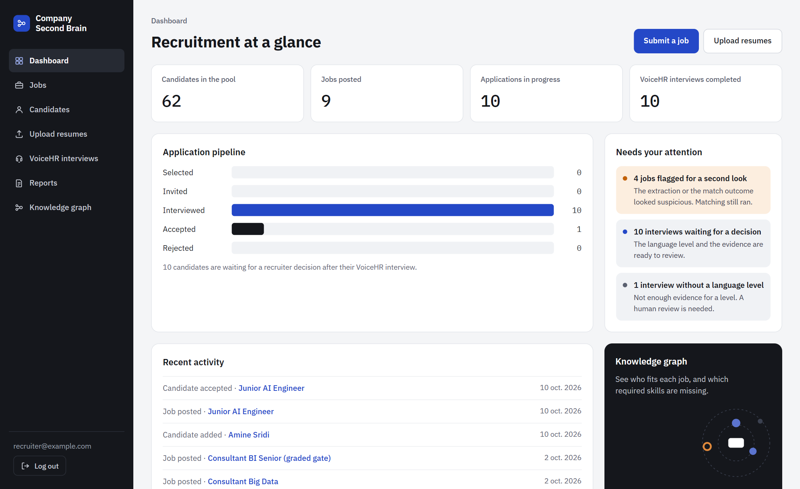<br><sub><b>Dashboard</b>: pipeline and what needs attention</sub></td>
    <td width="50%">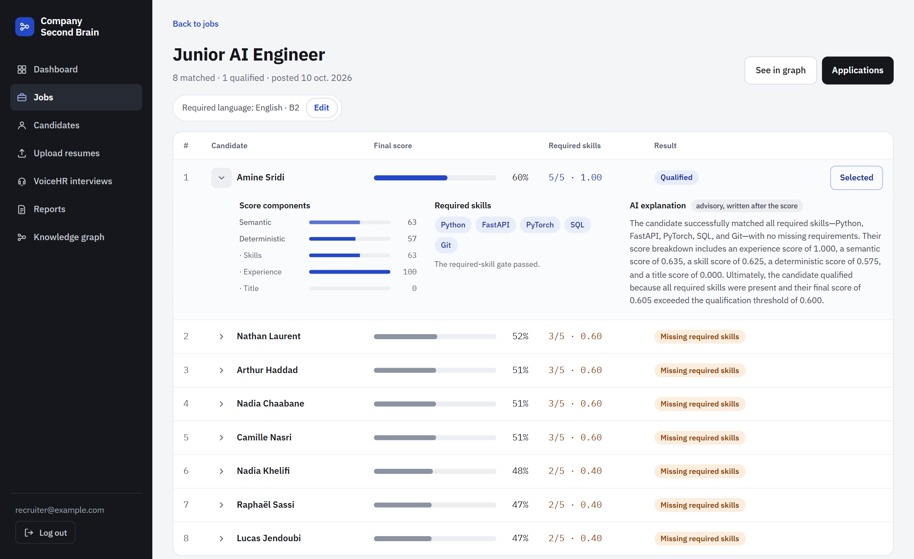<br><sub><b>Ranked matches</b>: score components, required skills, advisory explanation</sub></td>
  </tr>
  <tr>
    <td width="50%">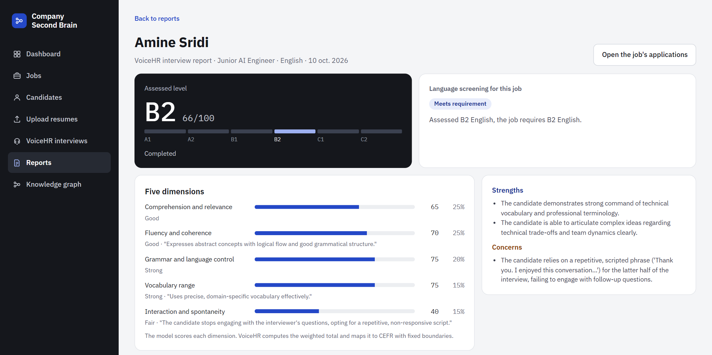<br><sub><b>Interview report</b>: CEFR level, five dimensions, strengths and concerns</sub></td>
    <td width="50%">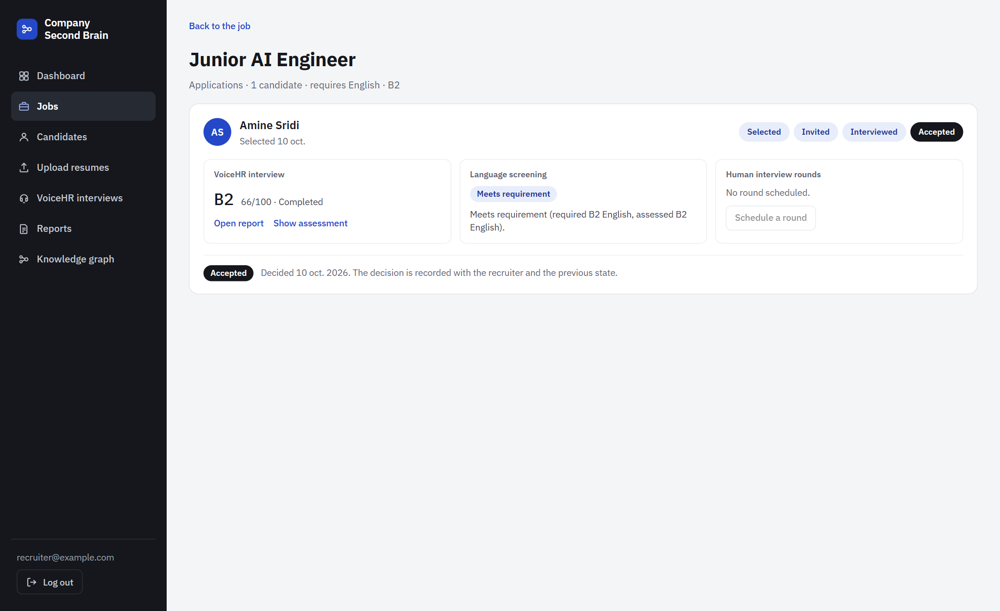<br><sub><b>Application</b>: lifecycle, language gate, decision</sub></td>
  </tr>
  <tr>
    <td width="50%">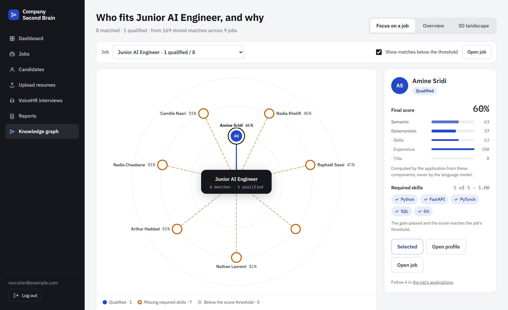<br><sub><b>Knowledge graph, focus view</b>: closer to the centre is a better fit</sub></td>
    <td width="50%">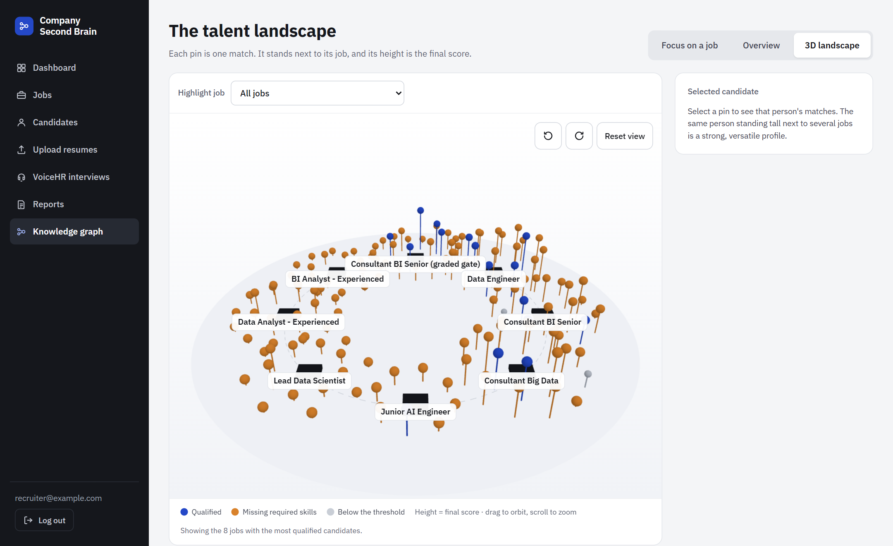<br><sub><b>3D landscape</b>: pin height is the final score</sub></td>
  </tr>
</table>

The candidate's side is a separate page, served by VoiceHR from a private link: consent, a
microphone check, then a live conversation with a running transcript.

<p align="center">
  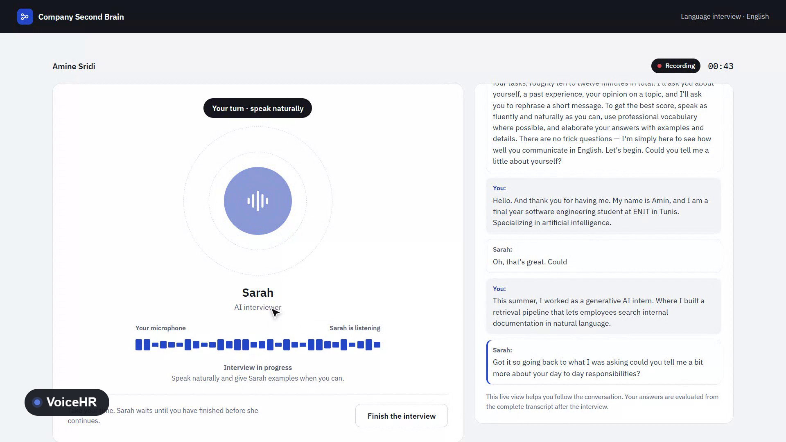
</p>

## Getting started

### Prerequisites

- Docker with Compose
- A **Gemini API key** for extraction, structuring, explanations, embeddings and the live interview
- Optional: a **Resend API key** to email interview invitations. Without a verified sending domain,
  Resend only delivers to the address its own account is registered under.
- Optional: an NVIDIA GPU for the local fallback model server

### Run the stack

```bash
# 1. Configuration: one .env for Compose, one per service
cp infra/.env.example infra/.env
for s in resume-intelligence second-brain recruitment-workflow voicehr; do
  cp services/$s/.env.example services/$s/.env
done
# Edit them: add GEMINI_API_KEY (and RESEND_API_KEY), set the secrets, and make sure each role
# password in infra/.env matches the one inside that service's DATABASE_URL.

# 2. Build and start
docker compose -f infra/docker-compose.yml up -d --build

# 3. Check
docker compose -f infra/docker-compose.yml ps
```

The first start creates the three schemas, the `pgvector` extension and the three database roles,
and each service applies its own Alembic migrations. If you have no NVIDIA GPU, leave out the
optional Ollama container; the command is in [infra/README.md](infra/README.md).

| What | Where |
|---|---|
| Recruiter interface and API | http://localhost:8003 (API docs at `/docs`) |
| Candidate interview page | http://localhost:8000, opened from the invitation link |
| PostgreSQL | `localhost:5432` |

Resume Intelligence and Second Brain are deliberately not published to the host.

Sign in with the seeded recruiter account (`SEED_RECRUITER_EMAIL` and `SEED_RECRUITER_PASSWORD` in
`services/recruitment-workflow/.env`). There is no registration. Then follow the demo: **Upload
resumes**, **Submit a job**, select a qualified candidate, and send the invitation.

## Testing

```bash
pip install -r requirements-dev.txt
pip install -r services/recruitment-workflow/requirements.txt
python scripts/run_tests.py              # every suite, live progress, exit code 0 when green
python scripts/run_tests.py --containers # also checks the LLM fallback inside the running stack
```

**856 tests pass, 7 are skipped, across 7 suites** (shared unit, workflow, Resume Intelligence,
Second Brain, VoiceHR, and the frontend's logic and component tests). None of them needs Docker,
Postgres, Redis, Ollama or a Gemini key; tests that would need one skip explicitly. The suites focus
on invariants that matter here: the hard gate cannot be bypassed, scoring is deterministic, a failed
job submission leaves no partial data, a duplicate webhook is applied once, and no identity field
crosses a service boundary.

Host tests cannot see everything inside a built image, so a separate script checks the running
containers, and a cross-service integration suite runs against a disposable database behind a
fail-closed guard. [docs/TESTING.md](docs/TESTING.md) lists every suite, its command and its
blind spots. GitHub Actions runs the suites on every push.

## Measured results

Decisions were made from measurements, and several measurements corrected the original plan. Full
tables and figures are in the project report; the supporting scripts and raw results are in
[`benchmarks/`](benchmarks).

| Result | Value |
|---|---|
| Automated tests | 856 passing, 7 skipped |
| Local open-weight models benchmarked on the platform's own tasks | 7 |
| Best local interview evaluator, agreement within one CEFR level | 0.90 (advisory only) |
| Local-only resume ingestion on one GPU | about 670 resumes per hour |
| Candidate lookup, batch versus sequential, at 40 candidates | 12.2 times faster |
| Full job submission, median | about 1.3 s |
| Real interview transcripts that can be graded after the sufficiency rule | 5 of 16 (was 0) |

**Local model selection.** The rule was fixed before reading the results: highest quality wins, a
difference under 0.05 is noise, the faster model breaks ties, and a task whose best model stays
under 0.70 gets no fallback.

| Task | Selected local model | Quality | Reason |
|---|---|---|---|
| Job structuring and repair | granite4.1:3b | 0.975 | Clear margin and fast |
| Resume extraction | granite4.1:3b | 1.000 | Tied on quality, fastest and smallest |
| Match explanation | llama3.2:3b | 1.000 | Tied on quality, chosen on latency |
| Interview evaluation | none | 0.600 | Best result is below the 0.70 floor |

**Assumptions the measurements corrected**

- Raising the ingestion worker's concurrency from 4 to 12 *lowered* throughput (909 to 823 resumes per
  hour), because the work was bound by one GPU.
- The candidate lookup the batch optimization targeted cost about 3 ms, not the 50 ms estimated. The
  optimization stayed, but its priority had rested on an unmeasured number.
- A first ranking of local evaluators was misleading because withheld verdicts were scored as
  errors. Regrading by what actually reaches the recruiter changed the winner.
- The 100,000-resumes-a-day target would need about 4,200 resumes per hour, which is roughly five of
  these GPUs under the measured conditions.

## Limitations and roadmap

The limits are known and stated:

- **Skills are compared as exact strings.** "SQL Server" does not match "SQL". The hard gate now
  uses a coverage floor so one unmatched token is no longer fatal, but a skill vocabulary is the
  most direct improvement. "Preferred" skills also count in the skill score, so a long nice-to-have
  list lowers every candidate's score.
- **Language thresholds are provisional.** Only a few real transcripts carry enough speech, and a
  synthetic voice is fluent by construction, so CEFR accuracy is not yet calibrated against a human
  rater. When evidence is insufficient the platform withholds a level instead of guessing.
- **A live voice session can drop.** The Gemini Live connection can time out or hit its session
  length limit. VoiceHR keeps the transcript and allows two reconnects, but a long interview can
  still exhaust them, and the audio recording of the last attempt overwrites earlier ones.
- **Single instance.** Rate limiting and resend delays are in memory. The platform has not been
  load-tested at production scale.
- **Privacy protection is field-based**, not content-based: contact details written into free text
  are not detected. Retention is run manually.

Next steps, as triggers rather than a wish list, are in
[docs/SCALING_AND_FUTURE_IMPROVEMENTS.md](docs/SCALING_AND_FUTURE_IMPROVEMENTS.md): a skill
vocabulary, calibration on real speech, privacy hardening, learning from stored recruiter
decisions, monitoring and shared state for several instances, and evaluation on a larger and more
varied candidate base.

## Repository layout

```text
services/
  resume-intelligence/     Resume upload, extraction pipeline, candidate identity, ingestion worker
  second-brain/            PII-free knowledge, embeddings, semantic retrieval
  recruitment-workflow/    Matching engine, workflow, API, and the React recruiter interface (frontend/)
  voicehr/                 Candidate interview page, live session, evaluation, report
shared/                    Shared schemas (extra="forbid"), LLM provider interface, HTTP client, rate limiting
infra/                     Docker Compose, Postgres init (schemas, extension, roles), environment template
tests/                     Shared unit tests and the cross-service integration suite
scripts/                   Test runner, container checks, retention, orphan reconciliation, demo seeding
benchmarks/                Local-model, evaluator, ingestion and matching-latency benchmarks, with raw results
docs/                      Architecture decisions, testing guide, scaling notes, local-LLM study, audit
```

## Documentation

| Document | What it covers |
|---|---|
| [docs/ARCHITECTURE_DECISIONS.md](docs/ARCHITECTURE_DECISIONS.md) | The rules the platform is built under and why |
| [docs/TESTING.md](docs/TESTING.md) | Every test suite, its command, and what it cannot observe |
| [docs/LOCAL_LLM_BENCHMARK_AND_FALLBACK.md](docs/LOCAL_LLM_BENCHMARK_AND_FALLBACK.md) | The seven-model benchmark and the fallback design |
| [docs/SCALING_AND_FUTURE_IMPROVEMENTS.md](docs/SCALING_AND_FUTURE_IMPROVEMENTS.md) | What to change, and the measured trigger for each change |
| [docs/PROJECT_AUDIT_AND_IMPROVEMENT_PROPOSAL.md](docs/PROJECT_AUDIT_AND_IMPROVEMENT_PROPOSAL.md) | The internal audit and what was fixed |
| Service READMEs | [Resume Intelligence](services/resume-intelligence/README.md) · [Second Brain](services/second-brain/README.md) · [Workflow](services/recruitment-workflow/README.md) · [VoiceHR](services/voicehr/README.md) · [infra](infra/README.md) |

## About

Built by [Amine Sridi](https://github.com/Amine-Sridi) during an internship within the Groupe
Sintegra ecosystem, as a working prototype whose guarantees, limits and remaining risks are
explicit.

No license has been chosen yet, so all rights are reserved by default.
